<p align="center">
  
</p>

<p align="center">
  <a href="mailto:victorcolussi@outlook.com"></a>
  <a href="https://github.com/joaovcolussi?tab=repositories"></a>
  
</p>

---

### `> whoami`

```yaml
nome:        João Victor Colussi
classe:      engenheiro de dados (em formação)
missão:      conquistar o primeiro estágio / emprego na área
estudando:   python · sql · power bi — e java quando sobra tempo
filosofia:   "dado bruto é ruído; dado tratado é decisão"
canal:       victorcolussi@outlook.com
```

### `> cat ~/stack/boot.log`

<p align="center">
  
</p>

<p align="center">
  
</p>

### `> git log --stats`

<p align="center">
  
  
</p>

<p align="center">
  
</p>

### `> ./contribuicoes --render`

<p align="center">
  <picture>
    <source media="(prefers-color-scheme: dark)" srcset="https://raw.githubusercontent.com/joaovcolussi/joaovcolussi/output/snake-neon.svg" />
    <source media="(prefers-color-scheme: light)" srcset="https://raw.githubusercontent.com/joaovcolussi/joaovcolussi/output/snake-neon-light.svg" />
    
  </picture>
</p>

---

```console
jvc@colussi:~$ echo $STATUS
> aberto a estágio e oportunidades júnior em dados. bora conversar?
jvc@colussi:~$ exit
> conexão encerrada ▌
```
