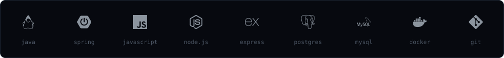

```java
var jvc = Developer.builder()
        .papel("backend")
        .linguagens(List.of("java", "c#", "javascript", "sql"))
        .runtime(List.of("jvm", "node.js"))
        .foco("APIs REST, código limpo e bancos relacionais")
        .build();
```



<picture>
  <source media="(prefers-color-scheme: dark)" srcset="https://raw.githubusercontent.com/joaovcolussi/joaovcolussi/output/snake-dark.svg" />
  <source media="(prefers-color-scheme: light)" srcset="https://raw.githubusercontent.com/joaovcolussi/joaovcolussi/output/snake-light.svg" />
  
</picture>

<sub><code>$ mail</code> <a href="mailto:victorcolussi@outlook.com">victorcolussi@outlook.com</a></sub>
